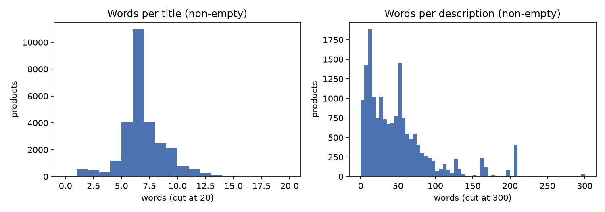
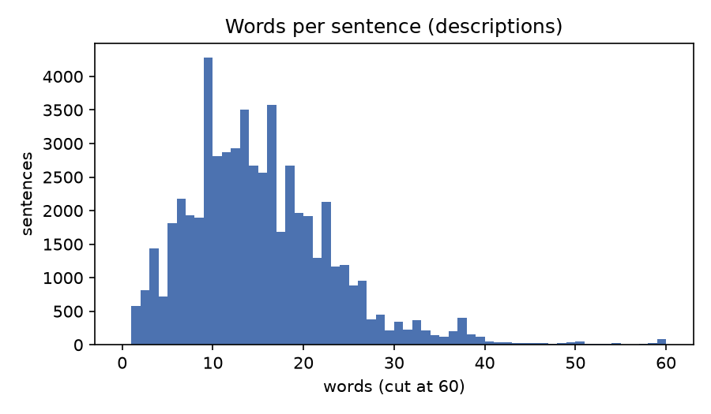
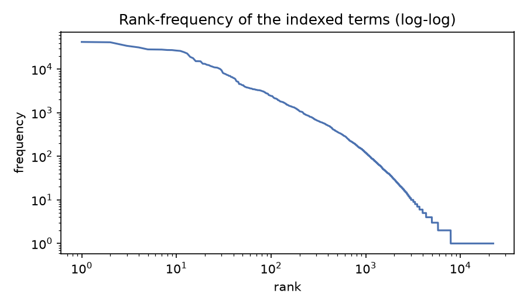
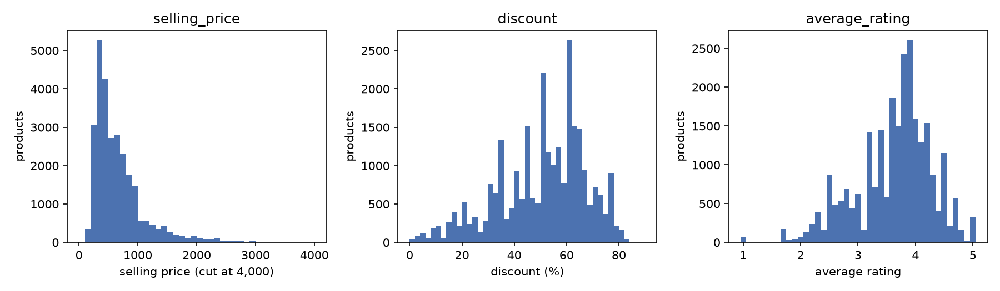
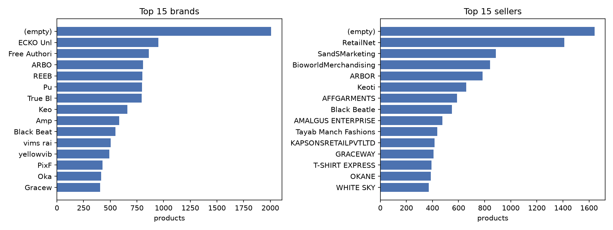
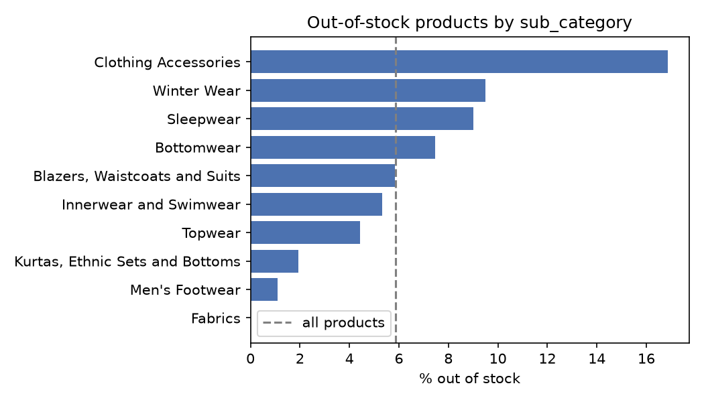
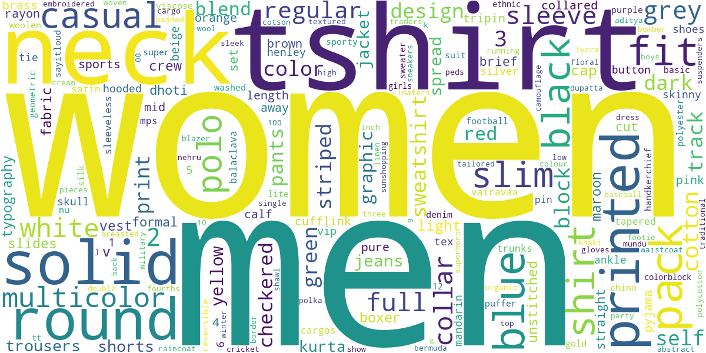
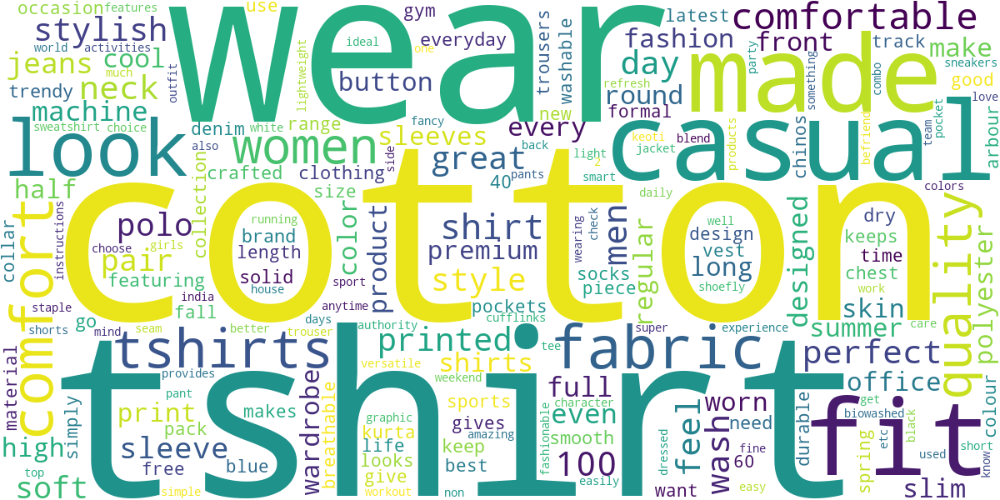

# IRWA Project – Part 1: Text processing and exploratory data analysis

## Repository

Code and results: <https://github.com/Vagaroto/RIAW-Presentaci-nFinal> (folder `Part1/`).

- The scripts are run from the `Part1/` folder.
- Packages: `pandas`, `nltk`, `matplotlib`, `wordcloud`, `spacy` and the spaCy model `en_core_web_sm`.
- Every number in this report can be checked in these files:

| File or folder | Content |
|---|---|
| `Part1/DataPreparation.py` | Text processing, the fields to index (`INDEXED_FIELDS`), the numeric values, and the `preprocess` function that builds the object of each product. |
| `Part1/FieldSelection.py` | Ranks the labeled products with BM25 for every combination of fields and saves the results in `Part1/field_selection_results/`. |
| `Part1/field_selection_results/` | `field_profile.csv`, `query_term_matches.csv`, `field_values.csv`, `ablation.csv`, `combinations.csv` and `rankings.csv`. |
| `Part1/DataChecks.py` | Saves the figures about the numeric fields and the `t-shirt` step in `Part1/data_checks_results/`. |
| `Part1/data_checks_results/` | `numeric_fields.csv` and `preprocessing_checks.csv`. |
| `Part1/EDA.py` | Exploratory data analysis (section 4). Saves tables in `Part1/eda_results/` and figures in `Part1/eda_results/figures/`. |
| `Part1/eda_results/` | One CSV file per table of section 4, named in each table. |
| `Part1/build_report.py` | Builds this PDF from `Report_Part1.md`. |
| `Part1/fashion_products_dataset.json` | The dataset. |
| `validation_labels.csv` | The relevance labels of the two reference queries. |

## 1. Data preparation

### 1.1 Text processing (`title`, `description` and the other indexed text fields)

Every text field goes through the same steps (`preprocess_text` in `DataPreparation.py`):

1. **Unicode normalization and diacritics removal** (NFKD, combining marks dropped), so `"Azúl"` and `"azul"` are the same term.
2. **Lowercasing.**
3. **Joining `t-shirt`:** `t-shirt` and `t shirt` become the single word `tshirt` (see below).
4. **Tokenization and punctuation removal:** the text is split into runs of word characters, so every punctuation mark acts as a separator. This also handles missing spaces such as `"look.Designed"` or `"Comfort,Skin"`.
5. **Stop-word removal** with the English list of NLTK.
6. **Stemming** with the Snowball stemmer of NLTK.

Steps 1 and 3 go beyond the required list (the "anything else" of the assignment). Step 3 is needed because the NLTK stop-word list contains the single letter `t`: without it, `"T-Shirt"` is reduced to `shirt` and cannot be told apart from a plain `"Shirt"`, which is a different product. 12,247 of the 28,080 titles contain `T-Shirt`, so the effect on retrieval would be large (`data_checks_results/preprocessing_checks.csv`). `Sweatshirt` is not affected, because it is already a single word.

Examples:

| Original | Processed tokens |
|---|---|
| `Solid Women Multicolor Track Pants` | solid, women, multicolor, track, pant |
| `Typography Women V Neck Multicolor T-Shirt  (Pack of 2)` | typographi, women, v, neck, multicolor, tshirt, pack, 2 |
| `Yorker trackpants made from 100% rich combed cotton giving it a rich look.Designed for Comfort,Skin friendly fabric,itch-free waistband & great for all year round use Proudly made in India` | yorker, trackpant, made, 100, rich, comb, cotton, give, rich, look, design, comfort, skin, friend, fabric, itch, free, waistband, great, year, round, use, proud, made, india |

Known limitation: the NLTK stop-word list also removes `no` and `not`, so negations are lost and values such as `Reversible = No` disappear from `product_details`. This was not changed.

Each product is stored as an object with four parts: the **original** record, untouched; the **processed** tokens (one list per field and the merged `text` that is indexed); the `numeric` values (section 3); and the `pid`. Retrieval works on the processed tokens, but the results are always returned from the original record.

### 1.2 Fields returned by a query

`pid`, `title`, `description`, `brand`, `category`, `sub_category`, `product_details`, `seller`, `out_of_stock`, `selling_price`, `discount`, `actual_price`, `average_rating` and `url` are taken from the original record, so none of them is affected by the preprocessing. `pid` is never modified because it is used in the evaluation.

## 2. Handling of `category`, `sub_category`, `brand`, `product_details` and `seller`

### 2.1 Decision

The fields `title`, `description`, `sub_category`, `brand` and `product_details` are **merged into one text field that is indexed**, without field weights. `category` and `seller` are **not indexed**, but they remain in the original record and are returned with the results. For `product_details`, which is a list of `{name: value}` pairs, only the values are kept (`Fit: Slim` contributes `slim`). The names are repeated in thousands of products and would only add noise.

### 2.2 Approaches considered

| Approach | Pros | Cons |
|---|---|---|
| **One merged text field** (chosen) | Simple index and a single ranking function. No weights to tune. A query term matches wherever it appears. | The origin of a term is lost (a word in the brand is the same as the word in the description). Long fields (`product_details` has 24 tokens on average) dilute short and distinctive ones (`brand`, `sub_category`). The importance of a field cannot be changed. |
| **Separate fields in the inverted index** | Each field can be searched or boosted alone. Short distinctive fields are not diluted by long ones. | It needs a way to combine the fields, normally weights, and those need data to be set. Here there are only 40 labeled products and 2 queries, too few to estimate them reliably. Sparse fields give no score (`description` is empty for 39.7% of the products, `brand` for 8.0%). More complexity and a larger index. |
| **Fields with few values as filters or facets** (alternative) | Exact results for values like `sub_category`. | The query would have to be translated into a filter, which a free-text search does not do. |

The merged field was chosen because the available evidence (section 2.4) is enough to decide which fields to use but not to estimate how much each one should weigh.

### 2.3 Distinctiveness of each field

| Field | Empty | Distinct values | Most common value | Comment |
|---|---|---|---|---|
| `category` | 0.0% | 4 | Clothing and Accessories (96.6%) | Almost constant: it does not separate products. |
| `sub_category` | 0.0% | 24 | Topwear (54.5%) | Few values: low distinctiveness alone. |
| `brand` | 8.0% | 324 | ECKO Unl (3.4%) | Distinctive: it identifies a product line. |
| `seller` | 6.0% | 534 | RetailNet (5.0%) | Distinctive, but it describes the vendor, not the product. |
| `product_details` | 0.0% | 95.3% of the products have a different text | – | The richest field: fit, sleeve, fabric, color, gender, neck. |

Source: `field_selection_results/field_profile.csv` (columns `empty_pct`, `distinct_raw_values` and `most_common_pct`).

### 2.4 How the choice was evaluated

The 40 products of `validation_labels.csv` (2 queries) were ranked with BM25 for every combination of fields (127 combinations, all merged into one text). A combination is better when the relevant products (label 1) are ranked above the non-relevant ones (label 0). This is measured with the AUC: 1.0 means every 1 is above every 0, and 0.5 is random.

| Field | AUC alone | Change in AUC when it is removed from the full set |
|---|---|---|
| `title` | 0.600 | −0.076 |
| `description` | 0.586 | −0.064 |
| `product_details` | 0.868 | −0.035 |
| `category`, `sub_category`, `brand`, `seller` | 0.500 | 0.000 |

Source: `field_selection_results/ablation.csv` for this table, `combinations.csv` for the scores of all combinations, and `rankings.csv` for the position of every labeled product. The full set scores 0.862, the best combination (`product_details` alone) 0.868, and the chosen combination 0.862. The difference between them is within the noise of a sample this small.

The evaluation was run again after joining `t-shirt` (section 1.1), and **all the scores were identical**, so the decision did not change. This is expected: neither query contains the word "shirt" (query 1 uses `sweatshirt`, which is a different term), so the labeled products cannot show the effect of that step.

### 2.5 Decision for each field

- **`title` (included).** It is weak alone because the labeled products already match the query words in the title, but removing it hurts the most (−0.076). It is also expected to be what finds the candidates in the whole collection, although the labeled products cannot test this.
- **`description` (included).** Removing it costs −0.064. It is empty for 39.7% of the products, so it cannot be the only source of terms.
- **`product_details` (included).** It is the strongest field: alone it reaches 0.868. It carries what separates relevant from non-relevant products. For query 1, `Sleeve = Full Sleeve` is relevant in 13 of 16 products and `Sleeve = Half Sleeve` in 0 of 4. For query 2, `Ideal For = Men` is relevant in 7 of 9 products and `Ideal For = Women` in 3 of 11 (`field_selection_results/field_values.csv`).
- **`sub_category` (included).** It does not change the score for these queries, because no query word appears in it. It is related to relevance (for query 1, `Winter Wear` is relevant in 13 of 16 products and `Topwear` in 0 of 4, see `field_values.csv`), it is short, and it lets queries such as "winter wear" match.
- **`brand` (included).** The evidence cannot confirm it, because neither query mentions a brand and its effect is 0.000. It is included by reasoning: brand names are highly distinctive and users search by brand. Its few tokens are diluted by the longer fields, which is the main weakness of the merged approach.
- **`seller` (not indexed).** Its effect is 0.000, and in the labeled products the same sellers appear on both relevant and non-relevant products (for query 1, `BioworldMerchandising` has 4 relevant products out of 8, see `field_values.csv`). It is distinctive, but it describes the vendor and not the product. A query word could match a seller name by accident.
- **`category` (not indexed).** 96.6% of the products share the same value, so its inverse document frequency is close to zero and it cannot discriminate. Its effect is 0.000.

### 2.6 Limitations of this evidence

- There are only 40 labeled products and 2 queries. Differences of a few thousandths in AUC are noise.
- The labeled products look like the top results of an earlier retrieval, so almost all of them match the query in the title. This understates the value of the title for finding candidates in the whole collection.
- A field that never contains a query word gives the same result whether it is used or not. That is the case for `category`, `sub_category`, `brand` and `seller`, so these four were decided by reasoning and not by the data.
- Some products with identical features have different labels, and some labels look noisy (women's jeans marked relevant for a "men" query). No choice of fields can fix this.

## 3. Numeric fields (`out_of_stock`, `selling_price`, `discount`, `actual_price`, `average_rating`)

### 3.1 Decision

These fields are **not indexed as textual terms**. Each preprocessed product keeps them in a separate `numeric` object, as clean values for the ranking stage:

| Field | Original format | Stored value |
|---|---|---|
| `selling_price` | text, e.g. `"921"` | number (float) |
| `actual_price` | text with thousands separator, e.g. `"2,999"` | number (float) |
| `discount` | text, e.g. `"69% off"` | percentage as a number (`69.0`) |
| `average_rating` | text, e.g. `"3.9"` | number from 1 to 5 |
| `out_of_stock` | boolean | boolean |

The original strings are not changed: they stay in the original record and are the ones returned to the user.

### 3.2 Justification

- **Numbers as text terms lose their meaning.** The tokens `999` and `1000` are unrelated terms, so the index cannot tell that two prices are close, or which one is higher. A text index cannot answer "cheaper" or "better rated" either.
- **They describe the product, not what it is.** Neither of the two reference queries mentions a price, a discount or a rating, so indexing them would add terms that match nothing useful. A term such as `69` could even match an unrelated product by accident.
- **They are natural signals for ranking.** Once converted to numbers they can be used to boost well-rated or discounted products, to push down products that are out of stock, or to filter by price range. This is what the ranking stage needs, and it does not require them in the inverted index.
- **Conversion removes the format problems.** The thousands separator (`"2,999"`) and the text around the discount (`"69% off"`) are removed, so every value of a field has the same type and unit.

### 3.3 Missing values

A missing value is stored as `None` and not filled in. A product without a rating is not a badly rated product, so inventing a value would distort the ranking. The ranking stage has to decide how to treat `None`.

| Field | Missing | Range |
|---|---|---|
| `selling_price` | 2 products | 99 to 7,999 |
| `actual_price` | 777 products (2.8%) | 150 to 12,999 |
| `discount` | 855 products (3.0%) | 1 to 87 (%) |
| `average_rating` | 2,261 products (8.1%) | 1.0 to 5.0 |
| `out_of_stock` | none | 1,644 products (5.9%) are out of stock |

Source: `data_checks_results/numeric_fields.csv`.

### 3.4 Not done yet

The values are only converted, not scaled. If the ranking combines them with the text score, they will need a common scale (for example 0 to 1). The prices are strongly spread (99 to 12,999), so that scaling is a decision for the ranking stage.

## 4. Exploratory data analysis

All tables come from `Part1/EDA.py`. The CSV file of each table is named under it (folder `Part1/eda_results/`).

### 4.0 Decisions taken for the analysis

- **Scope:** the whole collection (28,080 products). There is no sampling, not even for entity recognition.
- **Two token views:**
  - *raw* = `normalize_string` only (lowercase, no accents, no punctuation). Used for word counts, word clouds and readable terms.
  - *processed* = the indexed tokens of section 1 (after stop-word removal and stemming).
- **Empty fields are counted apart.** They are not treated as 0-word texts, so that they don't pull the averages down.
- **Long tails are cut only in the plots.** The cut is written on the axis. The tables use all the values.
- **Missing numeric values are left out** of the numeric statistics, as in section 3.3.
- **Ties in the rankings are broken by `pid`**, so the tables can be reproduced.

### 4.1 Word counts and sentence length

| Field | Empty | Raw: mean / median / p90 / max | Processed: mean / median / p90 / max |
|---|---|---|---|
| `title` | 0 | 6.5 / 6 / 9 / 36 | 6.3 / 6 / 8 / 31 |
| `description` | 11,150 (39.7%) | 50.2 / 39 / 107 / 637 | 31.2 / 25 / 67 / 579 |
| `product_details` (values) | 0 | 27.3 / 25 / 44 / 206 | 24.3 / 23 / 38 / 152 |
| merged indexed text | 0 | 66.9 / 46 / 124 / 682 | 52.1 / 41 / 91 / 623 |

Source: `word_counts.csv` (statistics over the non-empty values).

{width=95%}

| Measure (non-empty descriptions) | n | Mean | Median | p90 | Max |
|---|---|---|---|---|---|
| Sentences per description | 16,930 | 3.3 | 2 | 7 | 39 |
| Words per sentence | 56,500 | 15.0 | 14 | 25 | 136 |

Source: `sentence_lengths.csv`.

{width=60%}

- **Titles are short and uniform:** 6 words is the median, and 90% have 9 words or fewer. They follow a template (`<pattern> <gender> <neck> <color> <type>`, e.g. `Printed Men Round Neck Black T-Shirt`).
- **Descriptions are long, skewed and often missing.**
  - 39.7% of the products have no description.
  - The rest have 39 words as the median, but up to 637.
  - The peaks at about 160 and 210 words are template texts copied across products: a 160-word care-instructions text in 102 products, and a 207-word Shoefly polo text in 97 (`repeated_descriptions.csv`, section 4.2).
- **Preprocessing removes far more words from descriptions than from titles:**
  - descriptions lose 38% of their words (mean 50.2 → 31.2), because they're written in sentences full of stop words;
  - titles lose 3% (6.5 → 6.3), because they're already a list of keywords.
- **Length normalization will matter in the next part.** The merged text goes from 2 to 682 words, so a ranking without length normalization (raw TF) would favour long product pages. BM25's length normalization handles this.
- **Sentence splitting is done with a regex on `.`, `!` and `?`, not with `nltk.sent_tokenize`.** Many descriptions have no space after the period (`look.Designed`), which a standard sentence splitter treats as one word. The average sentence has 15 words.

### 4.2 Vocabulary, frequent terms and duplicates

| Field | Raw terms | Without stop words | Stemmed terms | Stemmed terms seen once |
|---|---|---|---|---|
| `title` | 793 | 774 | 743 | 233 |
| `description` | 6,311 | 6,183 | 4,704 | 973 |
| `sub_category` | 41 | 39 | 39 | 5 |
| `brand` | 424 | 404 | 403 | 42 |
| `product_details` | 19,963 | 19,856 | 19,366 | 13,867 |
| **merged indexed text** | **24,080** | **23,948** | **22,240** | **14,349 (64.5%)** |

Source: `vocabulary.csv`. The merged index holds 1,463,607 tokens.

{width=60%}

| Term (stemmed) | Products containing it | Where it comes from |
|---|---|---|
| `wear` | 74.7% | `Suitable For = Western Wear` (19,047 products), `sub_category` |
| `wash` | 73.1% | `Fabric Care = Regular Machine Wash` and variants |
| `cotton` | 71.0% | fabric in `product_details`, titles, descriptions |
| `1` | 70.2% | `Pack of = 1` (14,921 products) |
| `western` | 68.1% | `Suitable For = Western Wear` |
| `sleev` | 64.3% | `Sleeve = Full / Half Sleeve` |
| `regular` | 55.1% | `Fit = Regular` (11,835 products) |
| `topwear` | 54.5% | `sub_category` |
| `neck` | 51.9% | titles and `Neck = Round Neck` |
| `men` / `women` | 50.7% / 49.2% | titles and `Ideal For` |

Source: `top_terms.csv` (top 25), and the `product_details` values counted for this table.

| Duplicates | Value |
|---|---|
| Distinct titles | 5,953 of 28,080 |
| Products whose title is shared with another product | 24,462 (87.1%) |
| Distinct descriptions | 5,683 of 16,930 non-empty |
| Most repeated title | `Slides` (544 products), then `Printed Men Round Neck Black T-Shirt` (418) |
| Most repeated description | `High Quality Print Our t-shirts are printed using...` (302 products) |

Source: `duplicates.csv`, `repeated_titles.csv`, `repeated_descriptions.csv`.

- **The vocabulary is small but has a long tail.**
  - 22,240 indexed terms, of which 64.5% appear only once; the rank-frequency plot is close to a straight line (Zipf).
  - Most of these single terms come from `product_details`, which has 13,867 of them. 13,101 of those (94.5%) come from the `Style Code` value, which is present in 25,763 products and is a product identifier such as `1005COMBO2` (`style_code_terms.csv`).
  - They don't hurt ranking (a query never contains them), but they inflate the index. Removing the `Style Code` value is a cheap improvement, proposed in section 4.7.
- **Stemming mostly shrinks the description vocabulary:** 6,183 → 4,704 terms (−24%). Titles and brands barely change, because they're nouns already in base form.
- **Some terms are as common as stop words in this collection.**
  - `wear`, `wash`, `cotton`, `1`, `western` and `sleev` appear in 64–75% of the products, mostly from boilerplate values of `product_details`.
  - Their IDF is low, so they add little to the score. BM25 handles this on its own, so no domain stop-word list is added. This is reasoning: the effect was not measured.
  - `cotton` and `sleeve` are query words of query 1, so they'll weigh little in its score (section 4.7).
- **Titles are heavily duplicated:** 87.1% of the products share their title with at least one other product.
  - A title-only search can't separate them, and many products will tie on the text score.
  - This supports indexing `product_details` and `description` (section 2), and using the numeric fields to break ties (section 3).

### 4.3 Numeric fields and rankings

| Field | n | Mean | Q1 | Median | Q3 |
|---|---|---|---|---|---|
| `selling_price` | 28,078 | 705.6 | 390 | 545 | 820 |
| `actual_price` | 27,303 | 1,455.5 | 849 | 1,199 | 1,799 |
| `discount` (%) | 27,225 | 50.3 | 40 | 53 | 63 |
| `average_rating` | 25,819 | 3.63 | 3.2 | 3.8 | 4.1 |

Source: `numeric_summary.csv` (missing values left out).

{width=100%}

**Top 5 products of each ranking**

| Ranking | Products (brand as stored, value) |
|---|---|
| Highest rating | 329 products tie at 5.0. The top 10 by `pid` are all briefs and boxers, e.g. Men Brief (Pack of 5) (VIKING.INE). |
| Most expensive | Solid Women Track Suit (REEB, 7,999); Checkered Party Women Full Sleeve Blazer (True Bl, 7,998); Full Sleeve Solid Women Casual Jacket (Pu, 7,799); Full Sleeve Printed Men Sweatshirt (Pu, 7,799); Skinny Men Blue Jeans (G, 7,794) |
| Cheapest | Men Printed Bandana (99); Women Mid-Calf/Crew socks, pack of 2 (99); ankle socks, packs of 3 (118–120) |
| Highest discount | Printed Women Round Neck White T-Shirt (Jack Roy, 87%); two more Jack Roy T-shirts (86%); Printed Men Round Neck Multicolor T-Shirt, pack of 2 (yellowvib, 85%); Solid Balclava Cap (Gracew, 84%) |

Source: `top_rating.csv`, `prices.csv` (most expensive and cheapest), `top_discount.csv` (top 10 of each).

- **Prices are strongly right-skewed:** the median is 545, but there's a long tail up to 7,999.
  - A linear 0–1 scaling would squeeze most products into a narrow band.
  - So the ranking stage should use a log or rank (percentile) scale. This is a proposal, not done yet (section 3.4).
- **Discounts are high and spread out:** the median is 53%, and half of the products are between 40% and 63%. A big discount is the norm here, so it's a weak signal of a good deal.
- **Ratings cluster between 3.2 and 4.1,** and the median is 3.8.
  - The dataset has **no number of reviews**, so a 5.0 can't be told apart from a single review. 329 products tie at 5.0, and the top of that ranking is innerwear packs.
  - Rating should therefore be a mild boost, not a sort key. That is reasoning, not something the data can prove.
- **The prices tell us the market.** The site is Flipkart (the URLs), so the prices are almost certainly Indian rupees; the dataset doesn't state the currency.

### 4.4 Brands, sellers, sub-categories and stock

| Brand (as stored) | Products | Share | Out of stock | Mean rating |
|---|---|---|---|---|
| (empty) | 2,009 | 7.2% | 17.0% | 3.71 |
| ECKO Unl | 951 | 3.4% | 6.7% | 2.71 |
| Free Authori | 860 | 3.1% | 3.5% | 3.91 |
| ARBO | 806 | 2.9% | 2.9% | 4.10 |
| REEB | 802 | 2.9% | 8.4% | 4.01 |
| Pu | 798 | 2.8% | 12.5% | 4.06 |

| Seller | Products | Share | Out of stock | Mean rating |
|---|---|---|---|---|
| (empty) | 1,643 | 5.9% | 100.0% | 3.93 |
| RetailNet | 1,411 | 5.0% | 0.1% | 4.11 |
| SandSMarketing | 887 | 3.2% | 0.0% | 2.69 |
| BioworldMerchandising | 842 | 3.0% | 0.0% | 3.91 |
| ARBOR | 783 | 2.8% | 0.0% | 4.10 |

Source: `top_brands.csv`, `top_sellers.csv` (top 15 of each).

{width=100%}

**The `brand` field is truncated**

| Case (brand against the start of the URL path) | Products | Share |
|---|---|---|
| Brand is a cut-off prefix of the name in the URL | 24,741 | 88.1% |
| Brand empty | 2,009 | 7.2% |
| Brand not found in the URL | 964 | 3.4% |
| Brand matches the name in the URL | 366 | 1.3% |

| Stored brand | Name in the URL | Products |
|---|---|---|
| `ECKO Unl` | `ecko-unltd` | 951 |
| `Free Authori` | `free-authority` | 860 |
| `ARBO` | `arbour` | 806 |
| `REEB` | `reebok` | 802 |
| `Pu` | `puma` | 798 |
| `True Bl` | `true-blue` | 793 |

Source: `brand_truncation.csv`, `truncated_brands.csv`.

**Stock**

| Seller field | In stock | Out of stock |
|---|---|---|
| present | 26,436 | 1 |
| empty | 0 | 1,643 |

Source: `stock_vs_seller.csv`. Out of stock overall: 1,644 products (5.9%).

{width=70%}

| sub_category | Products | Out of stock |
|---|---|---|
| Topwear | 15,310 (54.5%) | 4.4% |
| Bottomwear | 3,666 | 7.5% |
| Winter Wear | 2,493 | 9.5% |
| Innerwear and Swimwear | 1,762 | 5.3% |
| Clothing Accessories | 1,742 | 16.9% |
| Kurtas, Ethnic Sets and Bottoms | 1,180 | 1.9% |
| Men's Footwear | 920 | 1.1% |
| Fabrics | 534 | 0.0% |

Source: `out_of_stock.csv` (sub-categories with at least 100 products), `sub_categories.csv`.

- **The stored brand is cut off in 88.1% of the products.** This is the most important finding for retrieval:
  - The full name is still in the URL (`Pu` → `puma`, `REEB` → `reebok`).
  - A query for "puma" or "reebok" matches no brand token today. So including `brand` in the index (section 2.5) gives little until the brand is recovered.
  - Recovering the name from the URL path is proposed in section 4.7. It was not applied in this part, so that the evaluation of section 2 stays valid.
- **An empty seller means the product is out of stock.** 1,643 of the 1,644 out-of-stock products have no seller, and every in-stock product has one.
  - The "most common seller" is therefore really "no seller".
  - `seller` carries no extra information beyond `out_of_stock`, which supports not indexing it (section 2.5).
- **The catalogue is dominated by a few brands and by Topwear:**
  - The top 15 brands hold 39.4% of the products (sum of the `share_pct` column in `top_brands.csv`, empty included).
  - Topwear alone is 54.5% of the products, so `sub_category` separates the other product types far better than it separates tops from each other.
- **Ratings differ by brand:** ECKO Unl averages 2.71 and ARBO 4.10. SandSMarketing (2.69) is probably the ECKO seller; that's reasoning from the similar counts, not something checked.
- **`sub_category` has dirty values.**
  - The same value appears with different capitalization (`Sunshopping` and `SUNSHOPPING Bags, Wallets & Belts`, `Inspire` and `INSPIRE ...`).
  - Some values are brand names (`Uber Urban Clothing and Accessories`).
  - Lowercasing during preprocessing already merges the capitalization variants in the index.
- **Out of stock varies by type:** Clothing Accessories is 16.9% out of stock, Fabrics 0%. In-stock products should be ranked above out-of-stock ones (section 3.2), but not removed, since the user may still want to see them.

### 4.5 Word clouds

**Decision:** word clouds are built from raw tokens with stop words removed, **not stemmed**. Stems such as `typographi` or `sleev` are hard to read, and the goal here is to describe the content, not the index.

{width=80%}

{width=80%}

- **Titles** are dominated by gender (`men`, `women`), garment type (`tshirt`, `shirt`, `polo`, `sweatshirt`, `jeans`) and visual attributes (`printed`, `solid`, `round`, `neck`, colours).
  - These are the words users type in queries, e.g. the two reference queries.
  - `tshirt` is a single word because of the joining step of section 1.1.
- **Descriptions** are dominated by marketing and material words (`cotton`, `wear`, `casual`, `comfort`, `look`, `made`, `fabric`, `quality`, `style`).
  - They describe material and use more than product type.
  - That explains why descriptions are useful but weaker than `product_details` in section 2.4.

### 4.6 Entity recognition

**Decision:** spaCy `en_core_web_sm` (named-entity recognizer, with the parser and lemmatizer disabled for speed) on all 16,930 non-empty descriptions (about 1.5 minutes). Titles and `product_details` aren't sentences, so they weren't analysed.

| Label | Mentions | Descriptions with it | Most frequent examples |
|---|---|---|---|
| ORG | 14,333 | 51.2% | Printed, KEOTI, "THE AMAZING COMFORT OF A Shoefly POLO T-SHIRTS", Sleeve, Tshirt |
| PERSON | 9,681 | 35.3% | Arbour, Casual Wear, Track Pant, Cotton, Casual |
| PERCENT | 5,483 | 21.6% | 100%, 60%, 40%, 20% |
| DATE | 5,425 | 25.0% | daily, weekend, Some days, all day |
| GPE | 4,157 | 15.7% | Cotton, kurta, India, Kurta, INDIA |
| CARDINAL | 3,548 | 17.3% | half, 2, 3, two, one |
| NORP | 1,792 | 9.8% | Jeans, Joggers, Indian |

Source: `entities_by_label.csv` (17 labels), `top_entities.csv` (top 30).

- **Most labels are wrong for this domain.**
  - The model was trained on news text, so capitalized product words are tagged as people, places or companies: `Cotton` and `kurta` as places, `Casual Wear` and `Track Pant` as people, `Printed` as an organization.
  - Garment names and attributes, the most important words here, have no entity type in this model.
- **Some results are correct and informative:**
  - **PERCENT** captures fabric composition (`60%` cotton / `40%` polyester).
  - **GPE** `India` captures the country of origin.
  - Some ORG and PERSON hits are real brands: `KEOTI`, `Arbour`, `Lucky Bird`, `Shoefly`.
- **Conclusion: entity recognition is not used in the preprocessing.**
  - Off-the-shelf NER would add noisy features, and the useful parts (brand, fabric, origin) are already structured in `brand` and `product_details`.
  - This also confirms the earlier decision not to anonymize. A tool such as Presidio would remove the brand names that NER finds, and those are search terms.

### 4.7 Implications for the next parts

**How common the query words are** (share of products whose indexed text contains the term)

| Query 1 word | Products | Query 2 word | Products |
|---|---|---|---|
| `women` | 49.2% | `men` | 50.7% |
| `full` | 25.6% | `slim` | 20.2% |
| `sleeve` (`sleev`) | 64.3% | `jeans` (`jean`) | 8.7% |
| `sweatshirt` | 5.0% | `blue` | 25.8% |
| `cotton` | 71.0% | | |

Source: `query_term_df.csv`.

- **Each query has one rare, decisive word** (`sweatshirt` 5.0%, `jeans` 8.7%), plus common words that mainly refine the result.
  - With IDF weighting, the product type will decide the candidates, and `women`/`men`, `full`, `slim` and `blue` will order them.
  - This matches section 2.5: the labels separate products by sleeve and gender, not by product type.
- **Proposed changes for the indexing stage** (not applied in this part, so the evaluation of section 2 stays valid):
  1. Recover the full brand name from the URL path (`Pu` → `puma`), because 88.1% of the brands are cut off.
  2. Drop the `Style Code` value from `product_details`: it's an identifier and adds thousands of terms that appear only once.
  3. Use `out_of_stock` to demote products (not to filter them), and use the numeric fields to break the many ties caused by duplicated titles.
  4. Scale price on a log or rank scale, and use rating as a mild boost only, because there is no review count.

