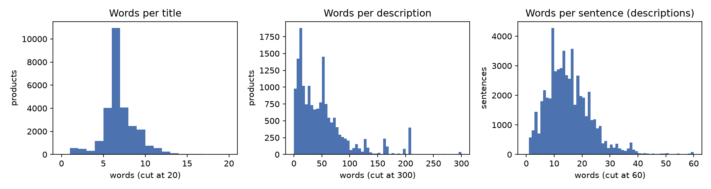
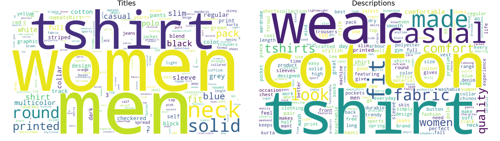

**Repository:** <https://github.com/Vagaroto/RIAW-Presentaci-nFinal>. The code is in `Part1/`, and the `README.md` explains how to run it and which file holds each number. Every table of this report names its source CSV file.

## 1. Data preparation

### 1.1 Text processing

Every indexed text field goes through `preprocess_text` (`DataPreparation.py`):

1. **Unicode normalization (NFKD) and accent removal**, so `Azúl` and `azul` are the same term.
2. **Lowercasing.**
3. **Joining `t-shirt`** (and `t shirt`) into `tshirt`.
4. **Tokenization and punctuation removal:** the text is split into runs of word characters, so punctuation acts as a separator. This also fixes missing spaces (`look.Designed`, `Comfort,Skin`).
5. **Stop-word removal** (NLTK English list).
6. **Stemming** (NLTK Snowball).

- **Extras beyond the statement:** steps 1 and 3.
- **Why step 3 is needed:**
  - The NLTK stop-word list contains the letter `t`, so `T-Shirt` would become `shirt`, a different product.
  - 12,247 of the 28,080 titles contain `T-Shirt` (`data_checks_results/preprocessing_checks.csv`).
  - `Sweatshirt` is one word and isn't affected.
- **Known limitation:** the NLTK list also removes `no` and `not`, so negations are lost (e.g. the value `Reversible = No`). This was not changed.

| Original | Processed tokens |
|---|---|
| `Solid Women Multicolor Track Pants` | solid, women, multicolor, track, pant |
| `Typography Women V Neck Multicolor T-Shirt (Pack of 2)` | typographi, women, v, neck, multicolor, tshirt, pack, 2 |
| `...rich combed cotton giving it a rich look.Designed for Comfort,Skin friendly fabric...` | ..., rich, comb, cotton, give, rich, look, design, comfort, skin, friend, fabric, ... |

### 1.2 Stored object and returned fields

- **Each product is stored as `{pid, original, processed, numeric}`:**
  - `original`: the untouched record.
  - `processed`: one token list per field, plus the merged `text` that is indexed.
  - `numeric`: the values kept for ranking (section 3).
- **Retrieval uses `processed`, but results are always returned from `original`.** So `pid`, `title`, `description`, `brand`, `category`, `sub_category`, `product_details`, `seller`, `out_of_stock`, `selling_price`, `discount`, `actual_price`, `average_rating` and `url` are returned unchanged.
- **`pid` is never modified**, because the evaluation uses it.

## 2. Handling of `category`, `sub_category`, `brand`, `product_details` and `seller`

### 2.1 Decision and approaches considered

**Decision:**

- `title`, `description`, `sub_category`, `brand` and `product_details` are **merged into one indexed text field, without field weights**.
- `category` and `seller` are **not indexed**, but they're still returned with the results.
- Of `product_details` (a list of `{name: value}` pairs) only the values are kept: `Fit: Slim` gives `slim`. The names repeat in thousands of products and would only add noise.

| Approach | Pros | Cons |
|---|---|---|
| **One merged field** (chosen) | Simple index and one ranking function; no weights to tune; a query term matches wherever it appears. | The origin of a term is lost. Long fields (`product_details`, 24 tokens on average) dilute short distinctive ones (`brand`, `sub_category`). Field importance can't be changed. |
| **Separate fields in the inverted index** | Each field can be searched or boosted alone; short fields aren't diluted. | Needs weights to combine the fields, and 40 labeled products and 2 queries are too few to estimate them. Sparse fields give no score (`description` is empty in 39.7% of the products, `brand` in 8.0%). Larger index. |
| **Low-cardinality fields as filters or facets** | Exact results for values like `sub_category`. | The query would have to be translated into a filter, which a free-text search doesn't do. |

The evidence of section 2.3 is enough to decide which fields to use, but not how much each should weigh. That is why the merged field was chosen.

### 2.2 Distinctiveness of each field

| Field | Empty | Distinct values | Most common value | Consequence |
|---|---|---|---|---|
| `category` | 0.0% | 4 | Clothing and Accessories (96.6%) | Almost constant: doesn't separate products |
| `sub_category` | 0.0% | 24 | Topwear (54.5%) | Few values: low distinctiveness alone |
| `brand` | 8.0% | 324 | ECKO Unl (3.4%) | Distinctive: identifies a product line |
| `seller` | 6.0% | 534 | RetailNet (5.0%) | Distinctive, but describes the vendor, not the product |
| `product_details` | 0.0% | 95.3% of products differ | – | Richest field: fit, sleeve, fabric, colour, gender, neck |

Source: `field_selection_results/field_profile.csv`.

### 2.3 Evaluation with the validation labels

**Method:**

- The 40 labeled products (2 queries) were ranked with BM25 for each of the 127 combinations of fields, each combination merged into one text.
- Each combination was scored with the **AUC**: the probability that a relevant product is ranked above a non-relevant one (1.0 = perfect, 0.5 = random).

| Field | AUC alone | Change in AUC when removed from the full set |
|---|---|---|
| `title` | 0.600 | −0.076 |
| `description` | 0.586 | −0.064 |
| `product_details` | 0.868 | −0.035 |
| `category`, `sub_category`, `brand`, `seller` | 0.500 | 0.000 |

Source: `ablation.csv`, `combinations.csv` (all combinations) and `rankings.csv` (position of every labeled product), in `field_selection_results/`.

- **The full set scores 0.862, and so does the chosen set.** The best combination is `product_details` alone, at 0.868. A difference that small is noise with 40 labels.
- **The `t-shirt` step didn't change any score.** Neither query contains `shirt`, so these labels can't show its effect.

### 2.4 Decision for each field

- **`title`, included:**
  - Removing it hurts the most (−0.076).
  - It's weak alone because every labeled product already matches the query in its title.
- **`description`, included:** removing it costs −0.064. It's empty in 39.7% of the products, so it can't be the only source of terms.
- **`product_details`, included:**
  - It's the strongest field (0.868 alone), because it carries what separates relevant from non-relevant products:
    - Query 1: `Sleeve = Full Sleeve` is relevant in 13 of 16 products, `Half Sleeve` in 0 of 4.
    - Query 2: `Ideal For = Men` is relevant in 7 of 9, `Ideal For = Women` in 3 of 11.
  - Source: `field_values.csv`.
- **`sub_category`, included:**
  - Its effect is 0.000, because no query word appears in it.
  - It is still related to relevance: for query 1, `Winter Wear` is relevant in 13 of 16 products, `Topwear` in 0 of 4.
  - It's short, and it lets queries such as "winter wear" match.
- **`brand`, included by reasoning:**
  - Neither query names a brand, so the labels can't judge it.
  - Brand names are distinctive, and users search by brand.
  - Its few tokens are diluted by the long fields (see also section 4.4).
- **`seller`, not indexed:**
  - Its effect is 0.000.
  - The same sellers appear on relevant and non-relevant products (`BioworldMerchandising`: 4 relevant of 8).
  - It describes the vendor, so a query word could match a seller by accident.
- **`category`, not indexed:** 96.6% of the products share one value, so its IDF is close to zero.
- **Limits of this evidence:**
  - Only 40 labels and 2 queries.
  - The labeled products look like the top results of an earlier search, so they all match the title, which understates `title`.
  - `category`, `sub_category`, `brand` and `seller` never contain a query word, so these four were decided by reasoning.
  - Some labels look noisy (women's jeans marked relevant for a "men" query).

## 3. Numeric fields (`out_of_stock`, `selling_price`, `discount`, `actual_price`, `average_rating`)

**Decision:** these fields are **not indexed as text terms**. They're converted into clean values in the `numeric` object, for the ranking stage. The original strings stay in `original` and are the ones returned.

| Field | Original | Stored | Missing | Range |
|---|---|---|---|---|
| `selling_price` | `"921"` | float | 2 products | 99 to 7,999 |
| `actual_price` | `"2,999"` | float (separator removed) | 777 (2.8%) | 150 to 12,999 |
| `discount` | `"69% off"` | percentage as a float (`69.0`) | 855 (3.0%) | 1 to 87 |
| `average_rating` | `"3.9"` | float, 1 to 5 | 2,261 (8.1%) | 1.0 to 5.0 |
| `out_of_stock` | boolean | boolean | none | 1,644 out of stock (5.9%) |

Source: `data_checks_results/numeric_fields.csv`.

- **Numbers as text lose their meaning.** `999` and `1000` would be unrelated terms, so the index couldn't tell that two prices are close, or answer "cheaper" or "better rated".
- **They describe the offer, not the product.** Neither reference query mentions a price or a rating, and a term like `69` could match an unrelated product by accident.
- **They're natural ranking signals:**
  - boost well-rated or discounted products;
  - push down products that are out of stock;
  - filter by price range.
- **Missing values are stored as `None`, not filled in.** A product without a rating is not a badly rated product, so the ranking stage decides how to treat `None`.
- **Not done yet: scaling.** Prices are very spread out, so a common scale is a decision for the ranking stage (section 4.3).

## 4. Exploratory data analysis

**Decisions taken for the analysis:**

- **Scope:** all 28,080 products, with no sampling.
- **Two token views:**
  - *raw* = normalized only, used for counts and word clouds;
  - *processed* = the indexed tokens.
- **Empty fields are counted apart**, not as 0-word texts.
- **Tails are cut only in the plots.** The cut is written on the axis.
- **Ties in the rankings are broken by `pid`**, so the tables can be reproduced.
- All files are in `Part1/eda_results/`.

### 4.1 Word counts and sentence length

| Field (non-empty values) | Empty | Raw words: mean / median / p90 / max | Processed: mean / median / p90 / max |
|---|---|---|---|
| `title` | 0 | 6.5 / 6 / 9 / 36 | 6.3 / 6 / 8 / 31 |
| `description` | 11,150 (39.7%) | 50.2 / 39 / 107 / 637 | 31.2 / 25 / 67 / 579 |
| `product_details` (values) | 0 | 27.3 / 25 / 44 / 206 | 24.3 / 23 / 38 / 152 |
| merged indexed text | 0 | 66.9 / 46 / 124 / 682 | 52.1 / 41 / 91 / 623 |

Source: `word_counts.csv`. Sentences (`sentence_lengths.csv`): 3.3 per description on average (median 2, max 39), and 15.0 words per sentence (median 14, p90 25).

{width=90%}

- **Titles are short keyword templates** (`<pattern> <gender> <neck> <colour> <type>`, e.g. `Printed Men Round Neck Black T-Shirt`).
- **Descriptions are long, skewed and often missing.** The peaks at about 160 and 210 words are template texts copied across products: a care-instructions text in 102 products and a Shoefly polo text in 97 (`repeated_descriptions.csv`).
- **Preprocessing removes 38% of description words but only 3% of title words.** Descriptions are sentences full of stop words, while titles are already keywords.
- **The indexed text ranges from 2 to 682 words**, so the ranking needs length normalization, as BM25 provides.
- **Sentences are split with a regex on `.!?`, not `nltk.sent_tokenize`.** The missing space in `look.Designed` makes a standard splitter see one word.

### 4.2 Vocabulary, frequent terms and duplicates

| Field | Raw terms | Without stop words | Stemmed | Stemmed, seen once |
|---|---|---|---|---|
| `title` | 793 | 774 | 743 | 233 |
| `description` | 6,311 | 6,183 | 4,704 | 973 |
| `brand` | 424 | 404 | 403 | 42 |
| `product_details` | 19,963 | 19,856 | 19,366 | 13,867 |
| **merged indexed text** | **24,080** | **23,948** | **22,240** | **14,349 (64.5%)** |

Source: `vocabulary.csv` (also `sub_category`: 39 terms). The index holds 1,463,607 tokens. The rank-frequency curve follows Zipf's law (`figures/zipf.png`).

| Most common terms (stemmed) | Products | Origin |
|---|---|---|
| `wear` / `western` | 74.7% / 68.1% | `Suitable For = Western Wear` (19,047 products) |
| `wash` | 73.1% | `Fabric Care = Regular Machine Wash` and variants |
| `cotton` | 71.0% | fabric, titles, descriptions |
| `1` | 70.2% | `Pack of = 1` (14,921 products) |
| `sleev` | 64.3% | `Sleeve = Full / Half Sleeve` |
| `men` / `women` | 50.7% / 49.2% | titles, `Ideal For` |

Source: `top_terms.csv` (top 25).

- **Long tail of identifiers:**
  - 13,101 of the 13,867 `product_details` terms seen once (94.5%) come from the `Style Code` value, present in 25,763 products (`style_code_terms.csv`).
  - They never match a query, but they inflate the index.
- **Stemming mainly shrinks the description vocabulary** (−24%). Titles and brands are already base-form nouns.
- **Some terms appear in 64–75% of the products, close to stop words of this domain.** They come from boilerplate values.
  - Their IDF is low, so BM25 already gives them little weight, and no domain stop-word list is added. This is reasoning: the effect wasn't measured.
  - `cotton` and `sleeve` are words of query 1, so they'll count little in its score.
- **Heavy duplication** (`duplicates.csv`):
  - Only 5,953 distinct titles: 87.1% of the products share their title with another. The most common is `Slides` (544 products).
  - Only 5,683 distinct descriptions among the 16,930 non-empty ones.
  - Many products will tie on title text alone. This supports indexing `product_details` and using the numeric fields to break ties.

### 4.3 Numeric fields and rankings

| Field | n | Mean | Q1 | Median | Q3 |
|---|---|---|---|---|---|
| `selling_price` | 28,078 | 705.6 | 390 | 545 | 820 |
| `actual_price` | 27,303 | 1,455.5 | 849 | 1,199 | 1,799 |
| `discount` (%) | 27,225 | 50.3 | 40 | 53 | 63 |
| `average_rating` | 25,819 | 3.63 | 3.2 | 3.8 | 4.1 |

Source: `numeric_summary.csv`.

{width=80%}

| Ranking | Top products (brand as stored, value) |
|---|---|
| Highest rating | 329 products tie at 5.0. The top 10 by `pid` are all briefs and boxers, e.g. Men Brief (Pack of 5) (VIKING.INE). |
| Most expensive | Solid Women Track Suit (REEB, 7,999); Women Full Sleeve Blazer (True Bl, 7,998); Women Casual Jacket and Men Sweatshirt (Pu, 7,799) |
| Cheapest | Men Printed Bandana (99); women's socks, pack of 2 (99); ankle socks, packs of 3 (118–120) |
| Highest discount | Jack Roy women's T-shirts (87%, 86%, 86%); men's T-shirt pack of 2 (yellowvib, 85%) |

Source: `top_rating.csv`, `prices.csv`, `top_discount.csv` (top 10 of each).

- **Price is right-skewed** (median 545, max 7,999). A linear 0–1 scaling would squeeze most products together, so a log or rank scale is proposed.
- **High discounts are the norm** (median 53%, half between 40% and 63%), so a discount is a weak signal of a good deal.
- **Ratings cluster between 3.2 and 4.1, and there's no review count.** A 5.0 can't be told apart from a single review, so rating should be a mild boost, not a sort key. This is reasoning.
- The site is Flipkart, so the prices are almost certainly Indian rupees. The dataset doesn't state the currency.

### 4.4 Brands, sellers, sub-categories and stock

{width=75%}

| Stored brand | Name in the URL | Products | | Brand vs. URL | Products |
|---|---|---|---|---|---|
| `ECKO Unl` | `ecko-unltd` | 951 | | cut-off prefix | 24,741 (88.1%) |
| `Free Authori` | `free-authority` | 860 | | empty | 2,009 (7.2%) |
| `REEB` | `reebok` | 802 | | not in the URL | 964 (3.4%) |
| `Pu` | `puma` | 798 | | full match | 366 (1.3%) |

Source: `truncated_brands.csv`, `brand_truncation.csv`.

- **The stored brand is cut off in 88.1% of the products.** This is the most important finding for retrieval:
  - The full name survives only in the URL.
  - A query for "puma" or "reebok" matches no brand token today, so indexing `brand` (section 2.4) helps little until the name is recovered.
  - The fix isn't applied here, so that the evaluation of section 2 stays valid.
- **An empty seller means out of stock** (`stock_vs_seller.csv`):
  - 1,643 of the 1,644 out-of-stock products have no seller, and every in-stock product has one.
  - So the "largest seller" in the figure is really "no seller", and `seller` adds nothing beyond `out_of_stock`, which supports not indexing it.
- **The catalogue is concentrated** (`top_brands.csv`, `top_sellers.csv`, `sub_categories.csv`):
  - The top 15 brands hold 39.4% of the products, empty brand included.
  - Topwear is 54.5% of the products, so `sub_category` separates other types much better than it separates tops.
- **Ratings differ by brand:** ECKO Unl averages 2.71, ARBO 4.10.
- **`sub_category` has dirty values:**
  - Capitalization variants (`Sunshopping` / `SUNSHOPPING Bags, Wallets & Belts`); lowercasing already merges them in the index.
  - Brand names used as categories (`Uber Urban Clothing and Accessories`).

{width=45%}

- **Out of stock** is 5.9% overall, but it ranges from 16.9% (Clothing Accessories) and 9.5% (Winter Wear) to 0% (Fabrics) (`out_of_stock.csv`). These products should be demoted rather than removed, since the user may still want them.

### 4.5 Word clouds

**Decision:** the word clouds use raw tokens without stop words and **not stemmed**, because stems such as `typographi` are hard to read.

{width=80%}

- **Titles:**
  - They're dominated by gender (`men`, `women`), garment (`tshirt`, `shirt`, `polo`, `sweatshirt`, `jeans`) and visual attributes (`printed`, `solid`, `round neck`, colours).
  - These are the words users type, as in the two reference queries.
- **Descriptions:**
  - They're dominated by material and marketing words (`cotton`, `wear`, `casual`, `comfort`, `quality`).
  - They describe material and use more than product type, which explains why they're weaker than `product_details` in section 2.3.

### 4.6 Entity recognition

**Decision:** spaCy `en_core_web_sm` over all 16,930 non-empty descriptions (about 1.5 minutes). Titles and `product_details` aren't sentences, so they weren't analysed.

| Label | Descriptions with it | Most frequent examples |
|---|---|---|
| ORG | 51.2% | Printed, KEOTI, Shoefly polo slogan, Sleeve, Tshirt |
| PERSON | 35.3% | Arbour, Casual Wear, Track Pant, Cotton |
| DATE | 25.0% | daily, weekend, all day |
| PERCENT | 21.6% | 100%, 60%, 40% |
| CARDINAL | 17.3% | half, 2, 3, two |
| GPE | 15.7% | Cotton, kurta, India |

Source: `entities_by_label.csv` (17 labels), `top_entities.csv`.

- **Most labels are wrong for this domain.**
  - The model was trained on news, so capitalized product words become people, places or companies: `Cotton` is tagged as a place, `Casual Wear` as a person.
  - Garments and attributes have no entity type in this model.
- **A few results are useful:**
  - PERCENT gives the fabric composition (60% cotton / 40% polyester).
  - GPE `India` gives the country of origin.
  - Some ORG and PERSON hits are real brands (`KEOTI`, `Arbour`, `Lucky Bird`).
- **Conclusion: NER is not used in preprocessing.**
  - The useful parts are already structured in `brand` and `product_details`.
  - Anonymization (e.g. Presidio) would delete exactly those brand names, which are search terms.

### 4.7 Implications for the next parts

| Query 1 term | Products | Query 2 term | Products |
|---|---|---|---|
| `women` | 49.2% | `men` | 50.7% |
| `full` | 25.6% | `slim` | 20.2% |
| `sleeve` | 64.3% | `jeans` | 8.7% |
| `sweatshirt` | 5.0% | `blue` | 25.8% |
| `cotton` | 71.0% | | |

Source: `query_term_df.csv` (share of products whose indexed text contains the term).

- **Each query has one rare, decisive term** (`sweatshirt`, `jeans`). With IDF weighting it picks the candidates, and the common terms order them. This matches section 2.4: the labels separate products by sleeve and gender, not by type.
- **Proposed for the indexing stage** (not applied, to keep section 2 valid):
  1. Recover the full brand from the URL path.
  2. Drop the `Style Code` value.
  3. Demote, not filter, out-of-stock products, and use the numeric fields to break ties.
  4. Use a log or rank scale for price, and rating as a mild boost.
